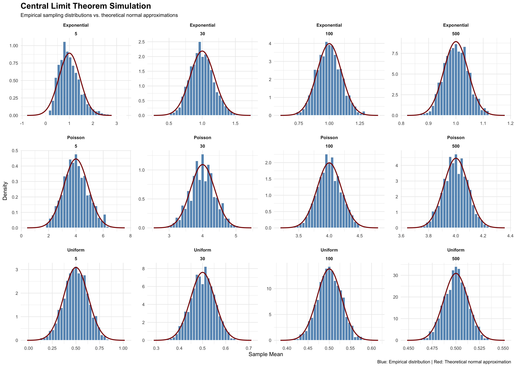

# Central Limit Theorem Simulation

A statistical simulation project in R demonstrating the **Central Limit Theorem (CLT)** through repeated random sampling from different probability distributions.

The project investigates how the sampling distribution of the sample mean approaches a normal distribution as the sample size increases, even when the underlying population distribution is not normal.

## Project Overview

The simulation uses three different population distributions:

- **Uniform Distribution**: Uniform(0, 1)
- **Exponential Distribution**: Exponential(rate = 1)
- **Poisson Distribution**: Poisson(λ = 4)

For each distribution, random samples are generated with four different sample sizes:

- 5
- 30
- 100
- 500

Each configuration is repeated 2,000 times to construct its sampling distribution.

## Methodology

The project follows these steps:

1. Generate random samples from each population distribution.
2. Calculate the sample mean for each repetition.
3. Construct empirical sampling distributions.
4. Compare the empirical distributions with their theoretical normal approximations.
5. Calculate and compare empirical and theoretical means and standard deviations.

The theoretical mean and standard deviation of the sample mean are:

$$
E(\bar{X}) = \mu
$$

$$
SD(\bar{X}) = \frac{\sigma}{\sqrt{n}}
$$


where:

- \(\mu\) is the population mean.
- \(\sigma\) is the population standard deviation.
- \(n\) is the sample size.

## Results and Visualization

The following figure compares the empirical sampling distributions (blue histograms) with their theoretical normal approximations (red curves).



### Key Observations

- The sampling distribution becomes increasingly concentrated around the population mean as the sample size increases.
- The standard deviation of the sample mean decreases proportionally to \(1/\sqrt n\).
- The sampling distributions become increasingly consistent with a normal distribution as the sample size grows.
- The approximation is less accurate for small samples drawn from strongly skewed populations, such as the exponential distribution.

## Statistical Summary

The simulation also calculates:

- Empirical mean
- Theoretical mean
- Absolute mean error
- Empirical standard deviation
- Theoretical standard deviation
- Absolute standard deviation error

The results are saved in:

`figures/simulation_summary.csv`

## Technologies

- R
- ggplot2

## Project Structure

```text
CLT-Simulation/
│
├── clt_simulation.R
├── README.md
│
└── figures/
    ├── clt_simulation.png
    └── simulation_summary.csv
```

## How to Run

### 1. Install R

Download and install R from:

https://cran.r-project.org/

### 2. Clone the repository

```bash
git clone https://github.com/YOUR_USERNAME/CLT-Simulation.git
cd CLT-Simulation
```

### 3. Run the simulation

```bash
Rscript clt_simulation.R
```

The script automatically installs `ggplot2` if it is not already installed.

### 4. View the outputs

The generated visualization and statistical summary will be saved in the `figures/` directory.

## Reproducibility

A fixed random seed (`set.seed(42)`) is used to ensure reproducible simulation results.

---

**Author:** Pasha Jome Bozorgi